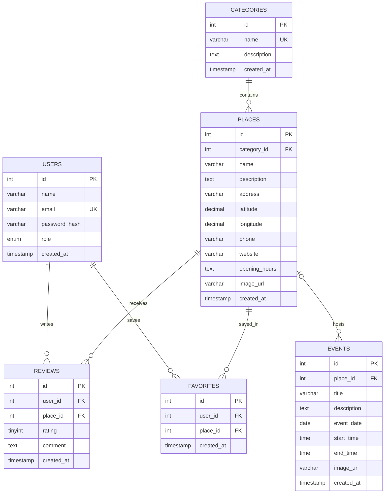

# Sarajevo2B Entity-Relationship Diagram

This document describes the planned relational database for Sarajevo2B. The entity definitions and foreign keys are based on the schema concept in `project_brief_document.md`.

## Entity Relationship Diagram

## Entities

### `users`

Stores registered accounts and their access roles.

| Column | Key | Description |
| --- | --- | --- |
| `id` | PK | Unique user identifier. |
| `name` | | User's display name. |
| `email` | UK | User's login email; must be unique. |
| `password_hash` | | Securely hashed password. Plain-text passwords must not be stored. |
| `role` | | Authorization role: `admin` or `user`. |
| `created_at` | | Account creation timestamp. |

### `categories`

Stores the different types of places available on Sarajevo2B.

| Column | Key | Description |
| --- | --- | --- |
| `id` | PK | Unique category identifier. |
| `name` | UK | Category name, such as Coffee Bars, Restaurants, Sweet Shops, Clubs & Bars, or Tourist Attractions. |
| `description` | | Description of the category. |
| `created_at` | | Category creation timestamp. |

### `places`

Stores information about locations, businesses, and tourist attractions in Sarajevo. Each place belongs to one category through `category_id`.

| Column | Key | Description |
| --- | --- | --- |
| `id` | PK | Unique place identifier. |
| `category_id` | FK → `categories.id` | Category to which the place belongs. |
| `name` | | Name of the place or attraction. |
| `description` | | Detailed description of the location. |
| `address` | | Physical address of the place. |
| `latitude` | | Geographic latitude for map integration. |
| `longitude` | | Geographic longitude for map integration. |
| `phone` | | Contact telephone number. |
| `website` | | Official website URL, if available. |
| `opening_hours` | | Opening and closing hours. |
| `image_url` | | URL of the place's representative image. |
| `created_at` | | Record creation timestamp. |

### `events`

Stores upcoming events taking place in Sarajevo. An event can optionally be associated with a specific place through `place_id`.

| Column | Key | Description |
| --- | --- | --- |
| `id` | PK | Unique event identifier. |
| `place_id` | FK → `places.id` | Location where the event takes place. Can be NULL for city-wide events. |
| `title` | | Event name. |
| `description` | | Event description and additional information. |
| `event_date` | | Date when the event takes place. |
| `start_time` | | Event starting time. |
| `end_time` | | Event ending time. |
| `image_url` | | URL of the event's representative image. |
| `created_at` | | Event creation timestamp. |

### `reviews`

Stores ratings and written feedback submitted by registered users about places they have visited.

| Column | Key | Description |
| --- | --- | --- |
| `id` | PK | Unique review identifier. |
| `user_id` | FK → `users.id` | User who submitted the review. |
| `place_id` | FK → `places.id` | Place being reviewed. |
| `rating` | | Numeric rating from 1 to 5. |
| `comment` | | Optional written feedback. |
| `created_at` | | Review creation timestamp. |

A unique constraint on (`user_id`, `place_id`) ensures that each user can submit only one review per place.

### `favorites`

Stores places that users have saved to their personal favorites lists.

| Column | Key | Description |
| --- | --- | --- |
| `id` | PK | Unique favorite identifier. |
| `user_id` | FK → `users.id` | User who saved the place. |
| `place_id` | FK → `places.id` | Place saved by the user. |
| `created_at` | | Date and time when the place was saved. |

A unique constraint on (`user_id`, `place_id`) prevents users from saving the same place multiple times.

## Relationships and Cardinality

- **Categories → Places:** One category can contain zero or many places. Each place belongs to exactly one category (`places.category_id`).
- **Places → Events:** One place can host zero or many events. Each event can be associated with zero or one place (`events.place_id`).
- **Users → Reviews:** One user can write zero or many reviews. Each review belongs to exactly one user (`reviews.user_id`).
- **Places → Reviews:** One place can receive zero or many reviews. Each review targets exactly one place (`reviews.place_id`).
- **Users → Favorites:** One user can save zero or many places. Each favorite belongs to exactly one user (`favorites.user_id`).
- **Places → Favorites:** One place can be saved by zero or many users. Each favorite references exactly one place (`favorites.place_id`).

## Integrity Rules

1. Every foreign-key value must reference an existing parent row, except nullable `events.place_id`.
2. `users.email` must be unique to prevent duplicate accounts.
3. `categories.name` must be unique to prevent duplicate categories.
4. `users.role` must be restricted to `admin` and `user`.
5. `reviews.rating` must be restricted to integer values from 1 through 5.
6. A user can submit only one review per place.
7. A user can save a particular place only once.
8. Deleting a category that still contains places must be restricted to prevent accidental loss of category relationships.
9. Deleting a user should cascade to their reviews and favorites.
10. Deleting a place should cascade to its reviews and favorites.
11. Deleting a place should set associated events' `place_id` to NULL instead of deleting the events.
12. All relationships should use appropriate foreign-key constraints and indexes.

## Scope Assumptions

The current database design uses five core entities (`users`, `categories`, `places`, `events`, and `reviews`) required for the main Sarajevo2B functionality.

The `favorites` entity is an additional sixth entity introduced to support the application's Favorites feature.

Each place belongs to exactly one category. If a future version needs places to belong to multiple categories, the database can be extended with a many-to-many junction table.

Events are optionally associated with a place because some events may take place across multiple locations or throughout the city.

The initial application focuses exclusively on Sarajevo, Bosnia and Herzegovina. Geographic coordinates are included to support possible future map integration.

The database is designed for MySQL and will be accessed through PHP PDO using prepared statements and a layered Route → Service → DAO → Database architecture.
